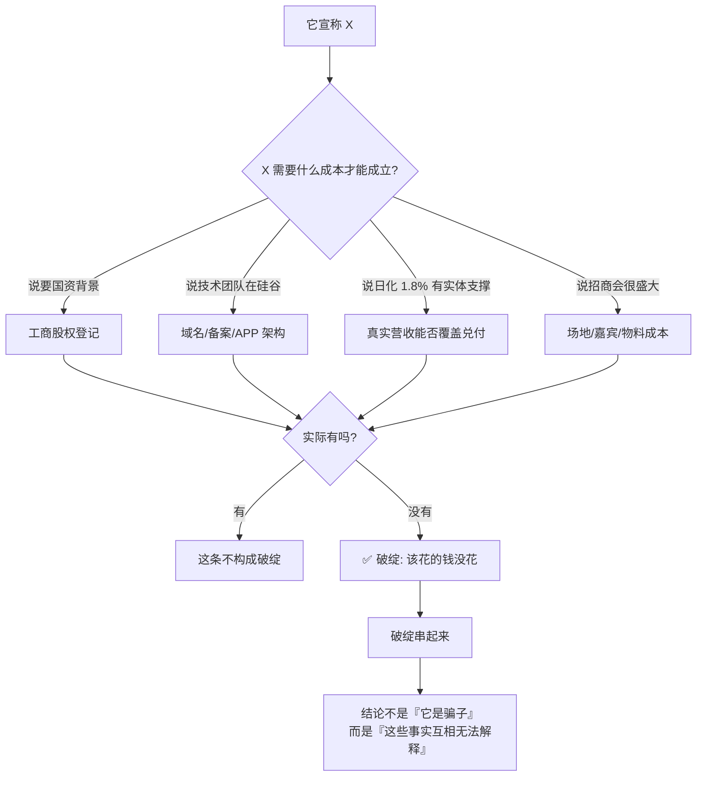
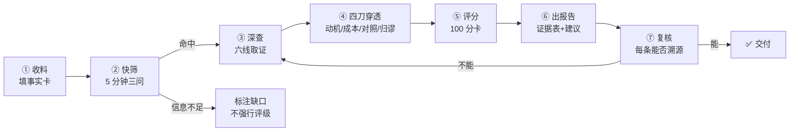

<div align="center">

# 投资项目风险审查方法论

**Fund Scam Audit**

把「怀疑」变成可执行的检查项 · 把「感觉像骗局」变成可复核的证据表

[](LICENSE)
[](LICENSE-DOCS)
[](https://www.python.org/)
[](tools/)
[](README_EN.md)

[中文](README.md) · [English](README_EN.md) · [快速开始](#-五分钟快速开始) · [方法论](docs/01-methodology.md) · [示例报告](examples/sample-report.md)

</div>

---

> 维护者 **janecoolman** ｜ 公众号「**金融防骗预警**」（ID：`jiancoolman`）
>
> 这个项目源于一件事：过去几年里，每天都有人把同一个问题丢过来——
> **「这个项目能不能投？」**
>
> 他们手上往往只有一张宣传截图、一段群里的语音、一个 APP 的名字。
> 他们不缺警惕心，缺的是**从哪一句开始怀疑**。
>
> 这套方法论就是为了回答这个问题：把一次判断拆成 18 个可核查的检查点，
> 每一项都要落到能追溯的公开来源，最后给一个分数和一句能说清楚的结论。

---

## 目录

- [这是什么](#这是什么)
- [这不是什么](#这不是什么)
- [为什么需要它](#为什么需要它)
- [核心原理](#核心原理)
- [安装](#安装)
- [五分钟快速开始](#五分钟快速开始)
- [完整工作流](#完整工作流)
- [评分体系](#评分体系)
- [工具说明](#工具说明)
- [输出示例](#输出示例)
- [免责与边界](#免责与边界)
- [常见问题](#常见问题)
- [贡献](#贡献)
- [许可](#许可)

---

## 这是什么

一套**可复现**的投资项目风险审查流程。输入是你能拿到的任何材料——项目名称、收益制度、宣传页截图、群聊记录、官网链接；输出是一份带评分的风险报告。

它不是"我一眼看出这是骗局"的玄学，而是**把判断过程拆开、摊平、让人能逐条复核**：

```
用户投料  →  事实卡  →  18 项检查  →  100 分评分卡  →  风险报告
            （分事实    （六条核查主线）  （A/B/C/D 四维）  （评级+证据+建议）
             与待核实）
```

三个核心资产：

| 资产 | 内容 | 为什么有用 |
|---|---|---|
| **六条核查主线** | 技术与资质 / 背书 / 制度 / 资金流 / 工商司法 / 舆论 | 把"查项目"这件事穷举成 18 个具体动作，不靠灵感 |
| **四把推理刀** | 动机反推 / 成本反推 / 对照法 / 归谬法 | 在证据不全时，用逻辑把结论逼出来 |
| **100 分评分卡** | 主体资质 25 + 收益结构 30 + 资金安全 25 + 外部信号 20 | 让"风险高低"变成可比较的数字，而不是形容词 |

**适用对象**：理财 / 挖矿 / 商城返利 / 山寨交易所 / 数字藏品 / 抢单互助 / 消费返利 / 各类"高收益"项目。

---

## 这不是什么

诚实地说明边界，比夸大能力重要：

| 它**不是** | 说明 |
|---|---|
| ❌ **不是法律意见** | 报告只做"特征比对"和"风险提示"，**不做法律定性**。一个项目是否构成犯罪，由司法机关认定。 |
| ❌ **不是投资建议** | 它不会告诉你"该买什么"，只会告诉你"哪些地方解释不通"。 |
| ❌ **不是自动判案机** | 工具做的是规则匹配和数学反算，**判断仍由人做出**。工具的价值是让你不漏项，不是替你思考。 |
| ❌ **不是"查了没查出问题=安全"** | 🟢 绿色评级的含义是"本次核查范围内未发现异常"，**不等于安全或合法**。 |
| ❌ **不是流量工具** | 不生产煽动性标题，不嘲讽受害者。目的是让人少亏钱，不是换阅读量。 |

---

## 为什么需要它

因为绝大多数人亏钱，不是因为贪，而是因为**没有能力验证一句听起来很合理的话**。

举个真实的结构：

> "我们有国资背景，注册资金 1000 万，日化 1.8%，推荐 3 代有奖。"

三句话，三个坑，而且每个坑都有对应的、**五分钟内就能查完**的验证动作：

| 它说 | 查什么 | 大概率查到 |
|---|---|---|
| 国资背景 | 国家企业信用信息公示系统：股东结构 | 没有国资股东，或只有一层无股权关系的"战略合作" |
| 注册资金 1000 万 | 同一页面：实缴资本 | 实缴 0 元。注册资本是认缴制，写一亿也不用真出钱 |
| 日化 1.8% | 算一下年化 | 约 673 倍。这个数字不需要判断力，需要计算器 |
| 推荐 3 代有奖 | 《禁止传销条例》第七条 | 团队计酬 + 门槛费 = 传销特征 |

**这就是全部秘密：不是要更聪明，是要知道查哪里。**

---

## 核心原理

### 一句话

> **项目方的自我描述不算证据。唯一方向是：它为了支撑那个说法，花了多少钱、办了多少事。**

### 图解



### 为什么结论必须这样表述

"某某是骗子"是一句**法律定性**，说错了要担责，而且无法证伪。
"备案主体是个人、实缴为零、日化 1.8%、提现限额"是一组**事实**，每一条都可追溯、可反驳。

前者是情绪，后者是证据。**只有后者能拿去给家人看、给警察看、给平台投诉用。**

---

## 安装

### 方式一：作为 Claude Code / WorkBuddy 技能使用（推荐）

```bash
# 克隆到技能目录
git clone https://github.com/janecoolman515/fund-anti-fraud.git \
  ~/.claude/skills/fund-anti-fraud

# WorkBuddy 用户：
git clone https://github.com/janecoolman515/fund-anti-fraud.git \
  ~/.workbuddy-ai/skills/fund-anti-fraud
```

装好后，直接说「帮我查一下这个项目」并附上资料，技能会自动触发。

**Windows 路径**：
```powershell
git clone https://github.com/janecoolman515/fund-anti-fraud.git "$env:USERPROFILE\.workbuddy-ai\skills\fund-anti-fraud"
```

### 方式二：只用工具链（不需要 AI）

```bash
git clone https://github.com/janecoolman515/fund-anti-fraud.git
cd fund-anti-fraud

# 无第三方依赖，Python 3.9+ 直接跑
python tools/apr_calculator.py --daily 1.8
python tools/scheme_audit.py examples/sample-case.json
python tools/report_builder.py examples/sample-case.json -o REPORT.md
```

> **零依赖**是这个项目刻意保持的设计。三个脚本只用了标准库，
> 因为查项目的人往往在手机上、在临时电脑上、在很急的时候——
> `pip install` 失败一次，可能就放弃了。

### 方式三：只读方法论（不需要装任何东西）

打开 [`docs/01-methodology.md`](docs/01-methodology.md)，照着 18 个检查点手查。工具只是加速，方法才是本体。

---

## 五分钟快速开始

假设有人推给你一个项目，叫「XX 国际」，日化 1.8%，推荐 3 代有奖。

### 第 1 分钟：算一下

```bash
python tools/apr_calculator.py --daily 1.8 --principal 10000
```

```
日化收益率          1.8000%
复利年化            673 倍
静态回本周期        56 天
司法保护上限(年化)  13.8%（一年期 LPR 3.45% × 4）
超出上限倍数        4868.7 倍
```

**结论**：这个收益率不是"偏高"，是**物理上不可能由实体经营支撑**。
一万块一年变 673 万，全世界没有任何生意做得到。

### 第 2 分钟：查主体

| 去哪查 | 查什么 | 看什么 |
|---|---|---|
| [工信部备案系统](https://beian.miit.gov.cn/) | 域名备案主体 | 是**个人**还是企业？备案名和项目名对得上吗？ |
| [国家企业信用信息公示系统](https://www.gsxt.gov.cn/) | 注册资本 **vs 实缴** | 实缴是 0 还是几千万？有没有经营异常？ |
| WHOIS 查询 | 域名注册 / 到期时间 | 注册不满一年？半年内到期？ |

### 第 3 分钟：查制度

看收益结构里有没有这三样：

- [ ] **门槛费**（不交钱就不能参与）
- [ ] **拉人计酬**（收益和"发展下线数量"挂钩）
- [ ] **锁仓复投**（想拿钱必须先再投钱）

这三样凑齐两样，就已经不是"投资"，是**资金再分配**。

### 第 4 分钟：跑一遍规则引擎

把查到的事实填进 JSON（照抄 [`examples/sample-case.json`](examples/sample-case.json) 的结构）：

```bash
python tools/scheme_audit.py my-case.json
```

```
🔴 极高风险      总分 86 / 100

【维度得分】
  A 主体资质   ████████████████████ 25/25
  B 收益结构   ████████████████████ 30/30
  C 资金安全   ████████████████████ 25/25
  D 外部信号   ██████░░░░░░░░░░░░░░  6/20
```

### 第 5 分钟：出报告

```bash
python tools/report_builder.py my-case.json -o REPORT.md
```

一份可直接转发的 Markdown 报告，含证据表、评分、结局推演、分阶段行动建议。

---

## 完整工作流



### ① 收料：把事实和待核实分开

```yaml
项目名:        XX国际
别名/曾用名:   （换皮盘常改名，必须记）
宣称类型:      理财 / 挖矿 / 商城返利 / 交易所 / 数藏 / 抢单
宣称收益:      日化 1.8%，7 天一轮
制度要点:      门槛费 / 推荐奖层级 / 锁仓 / 释放 / 烧伤 / 封顶
推广渠道:      微信群 / 抖音 / 线下招商会 / 熟人拉人
时间线:        起盘时间 / 出事时间 / 最近公告
用户疑虑:      提现不到账 / 强制复投 / 无法注销
```

> **这一步不下任何结论。** 事实卡填不完整是常态，缺什么就在报告里标"未能核实"。

### ② 快筛：5 分钟三问

```
问 1：收益从哪来？
     有真实经营（卖货/服务/算力）能对上账 → 继续问 2
     只能靠"拉人"和"后来者的钱"      → 🔴 直接命中庞氏结构

问 2：收益率是多少？
     日化 > 0.1%（年化 > 44%）→ 超出任何实体经营的合理回报
     日化 > 1%                → 一年 37 倍以上，无一例外

问 3：赚钱需不需要拉人？
     收益与"发展下线数量"挂钩 → 命中传销计酬特征
     有门槛费才能开始赚        → 命中传销入门费特征
```

### ③ 深查：六条主线

| 线 | 查什么 | 最硬的破绽信号 |
|---|---|---|
| **1 技术与资质** | 域名、备案、源码、APP 解包 | 个人备案 / 域名快到期 / 源码与同类完全一致 |
| **2 背书** | 名人、国企、证书、会议、团队 | 官方撇清声明 / 工商无股权关系 |
| **3 制度** | 门槛费、层级、日化、锁仓、封顶 | 拉人计酬无封顶 + 收益率脱离实体 |
| **4 资金流** | 提现、收款方、存管、造血 | 个人收款码 / 提现限额 / 无存管 |
| **5 工商司法** | 实缴、年报、异常、判决 | 实缴 0 元 / 经营异常 / 已有立案 |
| **6 舆论** | 搜索、投诉、监管公告 | 投诉集中同一模式 / 监管已提示 |

完整 18 个检查点见 [`docs/01-methodology.md`](docs/01-methodology.md)。

### ④ 四刀穿透

在证据不全的时候，用逻辑补位：

| 刀 | 问法 | 得到什么 |
|---|---|---|
| **动机反推** | 如果我是操盘手，什么时候跑最划算？ | 跑路时机本身就是信号 |
| **成本反推** | 真有钱的项目方会怎么花钱？ | 省了哪笔不该省的钱 |
| **对照法** | 换个基准比，它还站得住吗？ | 和历史同类盘、已判决案例的结构重合度 |
| **归谬法** | 把它的逻辑推到底会怎样？ | 话术自我崩塌 |

---

## 评分体系

> **分数越高 = 越危险。只对「已核实的事实」计分。**

| 维度 | 权重 | 检查项 |
|---|---|---|
| **A 主体资质** | 25 | 备案主体非企业(8) · 备案与宣称不符(4) · 实缴极低(5) · 工商异常(6) · 域名新/将到期(6) |
| **B 收益结构** | 30 | 日化≥1%(12) · 日化0.1~1%(6) · 拉人计酬无封顶(8) · 门槛费(5) · 锁仓复投(5) |
| **C 资金安全** | 25 | 提现受限(10) · 个人收款(6) · 无第三方存管(5) · 无造血业务(4) |
| **D 外部信号** | 20 | 监管提示(8) · 投诉集中(6) · 立案/判决(6) · 官方撇清(4) |

### 评级

| 得分 | 评级 | 含义 |
|---|---|---|
| **80–100** | 🔴 极高风险 | 命中多项核心违规特征，与已知资金盘/传销结构高度一致 |
| **60–79** | 🟠 高风险 | 存在多项无法解释的异常，强烈建议不参与 |
| **40–59** | 🟡 中风险 | 部分异常或信息不足，需补充核查 |
| **0–39** | 🟢 暂未发现明显违规 | **仅表示本次未发现，不代表安全或合法** |

### 一条重要的设计原则

**信息不足的项不计分，但会被记录为"信息缺口"。**

这避免了两种常见的误判：

- 查不到资料 → 记 0 分 → 得绿色评级 → **把"没查到"误当成"没问题"**
- 查不到资料 → 强行推断 → **把猜测写成事实**

报告里永远有一节「未能核实项」，明确列出"还不知道什么"。**承认不知道，比假装知道更有用。**

---

## 工具说明

### `tools/apr_calculator.py` — 收益反算

把一个承诺收益率换算成它必须满足的现实条件。

```bash
python tools/apr_calculator.py --daily 1.8 --cycle 7 --principal 10000 --members 1000
```

输出：日化→年化（单利/复利）、回本周期、超出司法保护上限倍数、周期自洽性检查、庞氏缺口测算。

**核心价值**：不是"收益高所以是骗局"（高收益本身不违法），
而是算出**这个收益率每年需要多少新资金来兑付**——当没有真实经营收入时，这个缺口只能由后来者填，而后来者终有耗尽的一天。

### `tools/scheme_audit.py` — 制度特征审查

18 条规则的匹配引擎。

```bash
python tools/scheme_audit.py examples/sample-case.json
python tools/scheme_audit.py examples/sample-case.json --explain   # 打印完整规则表
python tools/scheme_audit.py examples/sample-case.json --json      # 机器可读
```

### `tools/report_builder.py` — 报告生成

```bash
python tools/report_builder.py examples/sample-case.json -o REPORT.md
```

按案件所处阶段（未投 / 提现正常 / 提现变慢 / 要求再充值 / 已失联 / 已换皮），
自动生成对应的**结局推演**和**行动建议**。

### 案件 JSON 结构

照抄 [`examples/sample-case.json`](examples/sample-case.json)。核心字段：

```jsonc
{
  "project": { "name": "...", "aliases": [], "claimed_type": "...",
               "claimed_yield": "...", "stage": "withdrawal_slow" },

  "facts": {
    "entity":   { "icp_entity_type": "individual", "paid_in_capital": 0,
                  "business_status": "abnormal", "domain_age_days": 120 },
    "yield":    { "daily_rate": 1.8, "cycle_days": 7 },
    "scheme":   { "referral_levels": 3, "referral_capped": false,
                  "entry_fee": 998, "lockup": true },
    "funds":    { "withdrawal_limited": true, "payee_type": "personal",
                  "third_party_custody": false, "real_business": "weak" },
    "external": { "regulator_warning": false, "complaints": 47,
                  "legal_cases": 0, "official_denial": false }
  },

  "evidence": [
    { "item": "ICP 备案主体", "fact": "个人备案",
      "implication": "与宣称的集团无股权关系",
      "source": "工信部备案系统", "date": "2026-10-20" }
  ]
}
```

> 未核实的字段留空或填 `"unknown"`，引擎会跳过并记入信息缺口。

---

## 输出示例

完整示例见 [`examples/sample-report.md`](examples/sample-report.md)。节选：

```markdown
# 【风险审查】星辰国际（示例·虚构）

> **评级**：🔴 极高风险 ｜ **得分**：86 / 100 ｜ **信息完整度**：100%

## 三、证据表

| # | 核查项 | 查到的事实 | 说明什么 | 来源 |
|---|---|---|---|---|
| 1 | ICP 备案主体 | 备案主体为个人 | 宣称的「集团背景」在备案层面无对应主体 | 工信部备案系统 |
| 3 | 工商登记 | 注册资本 1000 万，实缴 0 元 | 宣称的资本实力无实缴支撑 | 国家企业信用信息公示系统 |
| 4 | 收益制度页 | 日化 1.8%，直推 3 代无封顶 | 年化约 673 倍，收益与拉人层级挂钩 | APP 制度页截图 |
| 5 | 收款方式 | 个人收款码 | 资金未进对公账户，无存管，追索困难 | 充值页截图 |

> 证据表每一行都可独立复核。「查到的事实」与「说明什么」严格分栏——
> 这是本报告能被采信的前提。
```

---

## 免责与边界

**必读。**

1. **本方法论只做特征比对与风险提示，不做法律定性。**
   一个项目是否违法，由金融监管部门与司法机关认定。报告中出现的
   "与传销特征吻合""存在庞氏结构特征"等表述，均为**结构描述**，
   不等同于"已构成犯罪"。

2. **所有事实必须可溯源。**
   报告中"查到的事实"一栏必须能追到公开来源（备案系统 / 工商系统 /
   判决书 / 监管公告 / 官方通报）。**不得编造、不得把推测写成事实。**

3. **区分事实与推断。**
   证据表刻意分成「查到的事实」和「说明什么」两栏。前者是证据，
   后者是基于证据的推断，读者可以不同意推断，但不能绕过事实。

4. **🟢 绿色评级不等于安全。**
   没有牌照审查能力的民间核查，**只能证伪，不能证真**。
   "本次未发现异常"和"这个项目没问题"是两件事。

5. **不嘲讽受害者。**
   怼盘不怼人。可以指出操盘手的手法，不嘲笑已经亏钱的人。

6. **保护隐私。**
   涉个人信息一律打码；不公开未判决案件的当事人身份信息。

7. **不替人做投资决定。**
   给风险评级和行动建议，不说"你一定会赚/一定亏"。

---

## 常见问题

<details>
<summary><b>Q：我没有技术背景，能用手册吗？</b></summary>

能。18 个检查点里有 14 个是"打开网站，查一个字段"，不需要任何技术能力。
真正需要一点技术的只有「源码比对」和「APP 解包」两项，跳过也不影响主要判断。

</details>

<details>
<summary><b>Q：只有项目名字，什么资料都没有，能查吗？</b></summary>

能，而且这是最常见的场景。从名字出发可以查到：备案主体、工商信息、
投诉记录、监管公告、媒体报道、社群痕迹。这些已经够覆盖 A、D 两个维度（45 分）。

</details>

<details>
<summary><b>Q：为什么不做"洗稿/改写"功能？</b></summary>

因为这个项目的目标是**判断真假**，不是**生产内容**。
把别人的文章改写一遍，既不能提高判断质量，也不解决读者的问题。
审查报告的价值在于"我查了什么、查到什么、这说明什么"——
这个结构无法通过改写别人的文章得到。

</details>

<details>
<summary><b>Q：评分 30 分的项目能投吗？</b></summary>

这个问题问错了。正确的问法是：**"我能不能承受这笔钱全部归零？"**
评分低只代表"本次核查未发现明显违规"，不代表合法、不代表安全、
不代表不会跑路。任何承诺高收益且收益与拉人挂钩的项目，
风险都不在评分里，而在结构里。

</details>

<details>
<summary><b>Q：我自己写的报告会不会被项目方找麻烦？</b></summary>

风险取决于表述方式。三条纪律能显著降低风险：

1. **只陈述可溯源的事实**，不写"这是骗子"；
2. **区分事实与推断**，推断部分明确标注"这是推断"；
3. **给出更正渠道**，报告末尾留一句"如与事实有出入，欢迎指出并提供证据，将及时更正"。

事实陈述 + 不越界定性 + 更正机制，是这类内容的基本自我保护。

</details>

<details>
<summary><b>Q：为什么不支持 YAML 输入？</b></summary>

为了保持零依赖。YAML 需要 PyYAML，JSON 是标准库。
"下载下来就能跑"比"语法好看一点"重要——尤其是在你很急的时候。

</details>

<details>
<summary><b>Q：规则库能改吗？</b></summary>

能。`tools/scheme_audit.py` 里的 `RULES` 是一个纯数据列表，
新增规则只需要加一行元组 + 一个判定函数。欢迎 PR。

</details>

---

## 贡献

欢迎补充：

- **新的检查项** —— 你遇到过但手册没覆盖的破绽类型
- **新的项目类型** —— 手册未收录的骗局变种（如新型数藏、AI 概念盘）
- **已判决案例的结构摘要** —— 用于"对照法"的基准库（**只收公开判决书内容**）
- **规则库扩充** —— `tools/scheme_audit.py` 的 `RULES`

提交前请确认：**不包含真实受害者的个人信息，不包含未公开的案件材料。**

详见 [CONTRIBUTING.md](CONTRIBUTING.md)。

---

## 许可

本项目采用**双许可**：

- **代码**（`tools/` 下的全部脚本）—— [MIT](LICENSE)，可自由使用、修改、商用
- **文档**（`SKILL.md`、`docs/`、`examples/`）—— [CC BY-NC-SA 4.0](LICENSE-DOCS)
  允许转载与改编，需署名、禁止商用、衍生作品须同协议共享

原因：工具应该被尽可能多的人用起来，方法论文档则是多年踩坑的沉淀，
不希望被人拿去包装成付费课程。

---

<div align="center">

**如果这份手册帮你避开了一个坑，请把它转给下一个可能踩进去的人。**

公众号「**金融防骗预警**」 · ID `jiancoolman` · 视频号 `Janecoolman01`

</div>
