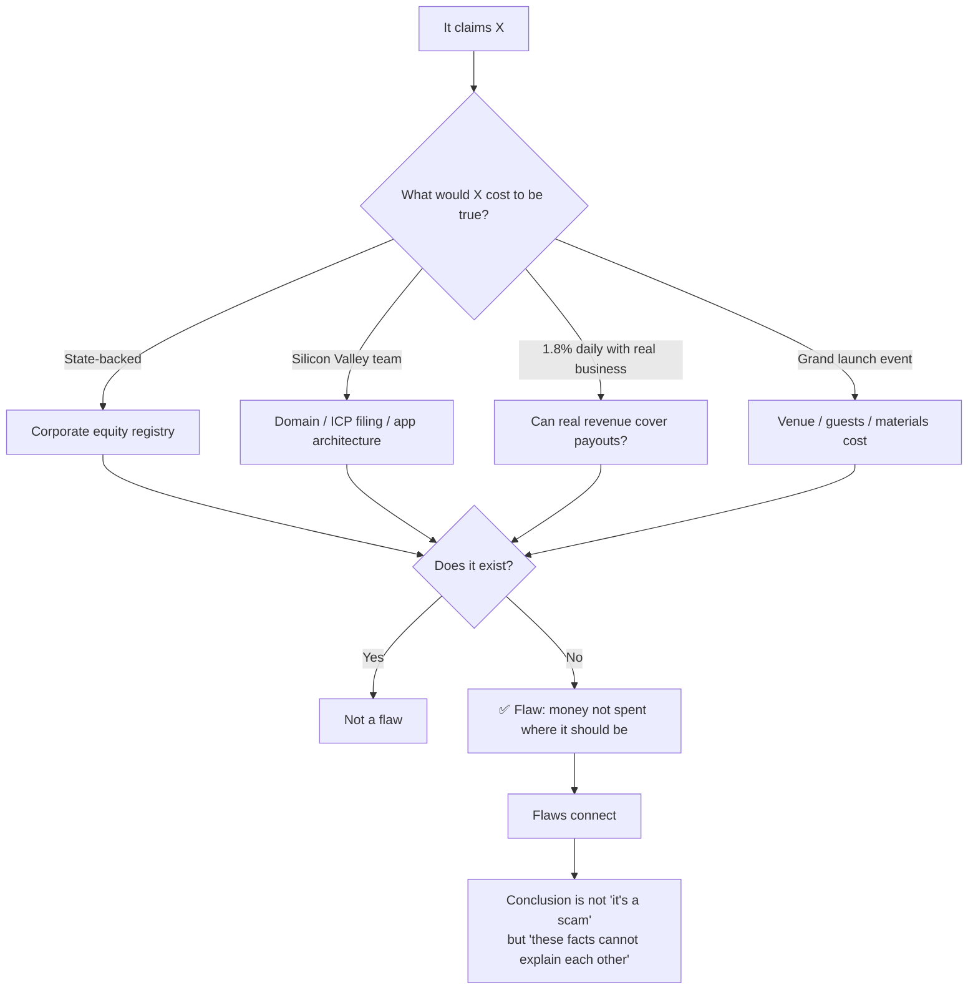

<div align="center">

# Fund Scam Audit

**A reproducible methodology for auditing suspicious investment projects.**

Turn a vague suspicion into a scored, source-traceable risk report.

[](LICENSE)
[](LICENSE-DOCS)
[](https://www.python.org/)
[](tools/)

[中文](README.md) · English · [Quick Start](#-quick-start) · [Methodology](docs/01-methodology.md) · [Sample Report](examples/sample-report.md)

</div>

---

> Maintained by **janecoolman** — WeChat account 「金融防骗预警」 (ID: `jiancoolman`)
>
> This project started with one question people kept asking:
> **"Can I invest in this?"**
>
> All they had was a screenshot, a voice message in a group chat, or just a name.
> They weren't short on caution. They were short on **knowing where to start doubting.**
>
> So the methodology breaks a judgement into 18 verifiable checkpoints,
> each traceable to a public source, ending in a score and a conclusion you can actually explain.

---

## What it is

An audit workflow. Input: whatever you have — a project name, a reward structure, a promo screenshot, a referral pitch. Output: a scored risk report.

It is **not** "I can tell it's a scam at a glance." It is the opposite: a deliberately slow, itemized, reviewable process.

```
Input  →  Fact sheet  →  18 checks  →  100-point scorecard  →  Report
         (facts vs.     (six tracks)    (A/B/C/D dimensions)   (rating + evidence
          unknowns)                                              + next steps)
```

Three core assets:

| Asset | What it is | Why it matters |
|---|---|---|
| **Six verification tracks** | Tech & licensing / Endorsements / Scheme design / Money flow / Corporate & legal / Public signals | Turns "investigate the project" into 18 concrete actions instead of intuition |
| **Four reasoning heuristics** | Operator motive / Cost reasoning / Benchmarking / Reductio ad absurdum | Produces conclusions when evidence is incomplete |
| **100-point scorecard** | Entity 25 + Yield 30 + Fund safety 25 + External 20 | Makes "how risky" a comparable number, not an adjective |

**Applicable to**: wealth-management schemes, cloud mining, shopping rebates, fake exchanges, digital collectibles, task-rebate / mutual-aid platforms, consumption-rebate schemes, and any "high yield" offering.

---

## What it is not

Being honest about limits matters more than overselling:

| It is **not** | Note |
|---|---|
| ❌ **Legal advice** | The report describes *characteristics* and *risk*. Whether a project is criminal is decided by courts, not by this tool. |
| ❌ **Investment advice** | It never says "buy this." It only says "these facts don't add up." |
| ❌ **An automatic verdict machine** | Tools match rules and do arithmetic. **The judgement is still yours.** |
| ❌ **Proof of safety** | A 🟢 rating means "nothing found in this audit" — **not** "safe" or "legal". |
| ❌ **A traffic play** | No outrage headlines. No mocking victims. The goal is fewer losses, not more views. |

---

## Why it exists

Most people don't lose money because they're greedy. They lose it because they **can't verify a sentence that sounds reasonable.**

A real structure:

> "We're state-backed, registered capital ¥10M, 1.8% daily, 3-level referral bonus."

Three claims, three traps, and each has a **five-minute** verification:

| Claim | Where to check | What you'll likely find |
|---|---|---|
| State-backed | Corporate registry: shareholder structure | No state shareholder — or a "strategic partner" with no equity link |
| ¥10M registered capital | Same page: **paid-in** capital | ¥0 paid-in. Registered capital is subscribed, not deposited |
| 1.8% daily | Do the math | ~673× annualized. This needs a calculator, not judgement |
| 3-level referral | Pyramid-scheme statutes | Team-based compensation + entry fee = pyramid characteristics |

**That's the whole secret: you don't need to be smarter. You need to know where to look.**

---

## Core principle

> **A project's self-description is not evidence. The only direction is: how much money and effort did it actually spend to support that claim?**



### Why the wording matters

"Company X is a scam" is a **legal conclusion** — risky to state, impossible to prove.
"ICP filing is under an individual's name, paid-in capital is zero, 1.8% daily, withdrawals are capped" is a set of **facts** — each traceable and falsifiable.

The first is emotion. The second is evidence you can show your family, the police, or a regulator.

---

## Installation

### Option 1: As a Claude Code / WorkBuddy skill (recommended)

```bash
git clone https://github.com/janecoolman515/fund-anti-fraud.git \
  ~/.claude/skills/fund-anti-fraud

# WorkBuddy users:
git clone https://github.com/janecoolman515/fund-anti-fraud.git \
  ~/.workbuddy-ai/skills/fund-anti-fraud
```

Then just say "check this project for me" with whatever material you have.

**Windows**:
```powershell
git clone https://github.com/janecoolman515/fund-anti-fraud.git "$env:USERPROFILE\.workbuddy-ai\skills\fund-anti-fraud"
```

### Option 2: CLI tools only (no AI needed)

```bash
git clone https://github.com/janecoolman515/fund-anti-fraud.git
cd fund-anti-fraud

# Zero dependencies. Python 3.8+ runs it directly.
python tools/apr_calculator.py --daily 1.8
python tools/scheme_audit.py examples/sample-case.json
python tools/report_builder.py examples/sample-case.json -o REPORT.md
```

> **Zero dependencies is a deliberate design choice.** People audit projects on
> their phone, on a borrowed laptop, in a hurry. If `pip install` fails once,
> they give up.

### Option 3: Read the methodology only

Open [`docs/01-methodology.md`](docs/01-methodology.md) and work through the 18 checkpoints by hand. Tools are speed; the method is the product.

---

## Quick start

Someone pitches you "XX International" — 1.8% daily, 3-level referral bonus.

### Minute 1: Do the math

```bash
python tools/apr_calculator.py --daily 1.8 --principal 10000
```

```
Daily rate          1.8000%
Compound annual     ~673x
Payback period      56 days
Legal cap (annual)  13.8% (1-yr LPR 3.45% x 4)
Multiple of cap     4868.7x
```

**Conclusion**: this isn't "high yield" — it's **physically impossible** to fund from real operations. ¥10,000 becomes ¥6.7M in a year. No business on earth does that.

### Minute 2: Check the entity

| Where | What | Look for |
|---|---|---|
| ICP filing system | Filing entity | **Individual** vs. company? Does the name match the brand? |
| Corporate registry | Registered **vs. paid-in** capital | Paid-in ¥0, or millions? Any "abnormal operations" flag? |
| WHOIS | Registration / expiry | Registered < 1 year? Expiring within 6 months? |

### Minute 3: Check the scheme

- [ ] **Entry fee** (can't participate without paying)
- [ ] **Recruitment-based compensation** (earnings tied to downline size)
- [ ] **Lock-up / forced reinvestment** (must deposit more to withdraw)

Two of these three, and it's no longer "investing" — it's **wealth redistribution**.

### Minute 4: Run the rule engine

Fill in a JSON case file (copy the structure from [`examples/sample-case.json`](examples/sample-case.json)):

```bash
python tools/scheme_audit.py my-case.json
```

```
[CRITICAL]  Score 86 / 100

Dimensions
  A Entity        ████████████████████ 25/25
  B Yield design  ████████████████████ 30/30
  C Fund safety   ████████████████████ 25/25
  D External      ██████░░░░░░░░░░░░░░  6/20
```

### Minute 5: Generate the report

```bash
python tools/report_builder.py my-case.json -o REPORT.md
```

A shareable Markdown report with an evidence table, score, exit-path projection, and stage-specific action items.

---

## Scorecard

> **Higher = more dangerous. Only verified facts score points.**

| Dimension | Weight | Checks |
|---|---|---|
| **A Entity** | 25 | ICP not a company (8) · Filing ≠ claimant (4) · Paid-in ≈ 0 (5) · Abnormal status (6) · Young/expiring domain (6) |
| **B Yield design** | 30 | Daily ≥ 1% (12) · Daily 0.1–1% (6) · Uncapped referral levels (8) · Entry fee (5) · Lock-up (5) |
| **C Fund safety** | 25 | Withdrawals restricted (10) · Personal payee (6) · No third-party custody (5) · No real revenue (4) |
| **D External** | 20 | Regulator warning (8) · Clustered complaints (6) · Legal cases (6) · Official denial (4) |

| Score | Rating | Meaning |
|---|---|---|
| **80–100** | 🔴 Critical | Multiple core violation characteristics; structurally consistent with known Ponzi/pyramid cases |
| **60–79** | 🟠 High | Multiple unexplained anomalies; strongly advise against participation |
| **40–59** | 🟡 Medium | Some anomalies or insufficient information; needs further verification |
| **0–39** | 🟢 Nothing found | **Only means "not found in this audit" — not safe, not legal** |

### A design principle worth noting

**Unverified items score nothing but are recorded as "information gaps."**

This avoids two common misjudgements:

- Can't find data → score 0 → green rating → **mistaking "not found" for "no problem"**
- Can't find data → force an inference → **writing speculation as fact**

Every report has a "Not verified" section. **Admitting what you don't know is more useful than pretending you do.**

---

## Tools

| Tool | Purpose |
|---|---|
| `tools/apr_calculator.py` | Yield reverse-engineering: daily → annualized, cycle consistency, Ponzi gap |
| `tools/scheme_audit.py` | 18-rule matching engine → dimension scores + hit list + gaps |
| `tools/report_builder.py` | Case JSON → full Markdown risk report |
| `data/` | Extensible rule references |

```bash
python tools/apr_calculator.py --daily 1.8 --cycle 7 --principal 10000 --members 1000
python tools/scheme_audit.py examples/sample-case.json --explain
python tools/report_builder.py examples/sample-case.json -o REPORT.md
```

---

## Sample output

See [`examples/sample-report.md`](examples/sample-report.md). Excerpt:

```markdown
# [Risk Audit] Stellar International (sample / fictional)

> **Rating**: 🔴 Critical | **Score**: 86 / 100 | **Coverage**: 100%

## Evidence

| # | Check | Fact found | What it implies | Source |
|---|---|---|---|---|
| 1 | ICP filing | Filed under an individual | Claimed "group backing" has no corresponding entity | MIIT filing system |
| 3 | Corporate registry | ¥10M registered, ¥0 paid-in | Claimed capital strength unsupported | National credit registry |
| 4 | Yield schedule | 1.8% daily, 3 levels, uncapped | ~673x annualized; earnings tied to recruitment | In-app screenshot |
| 5 | Payment method | Personal QR code | Funds never reach a corporate account; no custody | Deposit page screenshot |

> Every row is independently verifiable. "Fact found" and "what it implies"
> are deliberately separate columns — that's what makes the report citable.
```

---

## Disclaimer

**Required reading.**

1. **This methodology compares characteristics and flags risk. It does not make legal determinations.**
   Whether a project is illegal is decided by regulators and courts.
   Phrases like "consistent with pyramid-scheme characteristics" are **structural descriptions**,
   not findings of criminal liability.

2. **Every fact must be traceable.**
   Each item in the "Fact found" column must trace to a public source
   (filing system / corporate registry / judgment / regulator notice).
   **No fabrication, no speculation presented as fact.**

3. **Facts and inferences are kept separate.**
   The evidence table splits "Fact found" from "What it implies."
   Readers may disagree with the inference — but they cannot bypass the fact.

4. **🟢 does not mean safe.**
   A non-licensed civilian audit can **disprove, not prove**.
   "Nothing found" and "nothing wrong" are different claims.

5. **Never mock victims.** Attack the scheme, not the people who lost money.

6. **Protect privacy.** Redact personal information; never publish identities from unadjudicated cases.

7. **Never make the investment decision for someone.**
   Give a rating and a next step. Don't say "you will profit" or "you will lose."

---

## Contributing

Contributions welcome:

- **New checkpoints** — flaws you've encountered that the handbook misses
- **New scam variants** — AI-concept schemes, RWA tokenization, carbon-credit rebate schemes, etc.
- **Structural summaries of adjudicated cases** — for benchmarking (**public judgments only**)
- **Rule library expansion** — the `RULES` list in `tools/scheme_audit.py`

Before submitting, confirm: **no real victim's personal data, no unpublished case materials.**

See [CONTRIBUTING.md](CONTRIBUTING.md) (in Chinese).

---

## License

Dual-licensed:

- **Code** (`tools/`) — [MIT](LICENSE). Use it, modify it, ship it commercially.
- **Documentation** (`SKILL.md`, `docs/`, `examples/`) — [CC BY-NC-SA 4.0](LICENSE-DOCS).
  Redistribution and adaptation allowed with attribution; no commercial use; share-alike.

The split is intentional: tools should spread as widely as possible;
the methodology is years of accumulated field notes that shouldn't be repackaged into a paid course.

---

<div align="center">

**If this handbook helped you dodge one bad decision, pass it to the next person who might not.**

WeChat 「金融防骗预警」 · ID `jiancoolman` · Channels `Janecoolman01`

</div>
