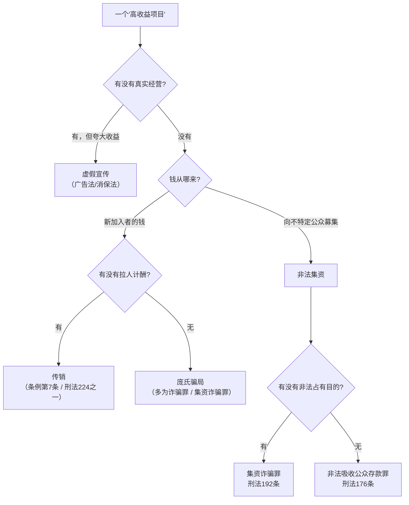

# 法律特征映射

> ⚠️ **本文不是法律意见。**
>
> 本文的作用是：让你知道**自己查到的事实，大致对应哪一类违法特征**，
> 从而能写出准确的表述、给出正确的建议。
>
> **认定一个项目是否违法，是金融监管部门与司法机关的职权。**
> 任何民间报告都不具备这个资格。

---

## 目录

- [一 · 三类违法行为的关系](#一--三类违法行为的关系)
- [二 · 传销的法定构成](#二--传销的法定构成)
- [三 · 非法集资的四要件](#三--非法集资的四要件)
- [四 · 非法吸收公众存款 vs 集资诈骗](#四--非法吸收公众存款-vs-集资诈骗)
- [五 · 虚拟货币相关监管文件](#五--虚拟货币相关监管文件)
- [六 · 利率的司法保护上限](#六--利率的司法保护上限)
- [七 · 特征映射表](#七--特征映射表)
- [八 · 表述红线](#八--表述红线)
- [九 · 如果收到律师函](#九--如果收到律师函)

---

## 一 · 三类违法行为的关系

很多项目同时踩中多条线。理解它们的关系，才能写准结论。



**关键点**：

- **传销** 的核心是"**拉人**"——收益来自发展人员，不一定需要"集资"
- **非法集资** 的核心是"**向公众募集**"——四个要件齐备
- **集资诈骗** 与 **非吸** 的区别是"**非法占有目的**"——即从一开始就没打算还

一个项目可以**同时构成**传销和非法集资。报告里可以写"同时具备 A 与 B 的特征"，
但**不写"构成 A 罪"**。

---

## 二 · 传销的法定构成

### 《禁止传销条例》（2005 年国务院令第 444 号）第七条

三种法定类型：

| 类型 | 原文要点 | 通俗理解 |
|---|---|---|
| **第（一）项 · 拉人头** | 发展人员，以**直接或间接滚动发展的人员数量**为依据计酬 | 拉一个人给一份钱，不看你卖了多少货 |
| **第（二）项 · 收取入门费** | 要求交纳费用或以**认购商品等方式变相交纳费用**，取得加入或发展他人的资格 | 不交钱就不能开始赚 |
| **第（三）项 · 团队计酬** | 形成上下线关系，以**下线的销售业绩**为依据计酬 | 你下线的业绩，你能抽成 |

**第二十四条**（处罚）：
组织策划传销的，由工商行政管理部门没收非法财物、没收违法所得，
处 50 万元以上 200 万元以下罚款；构成犯罪的，依法追究刑事责任。

### 《刑法》第 224 条之一 · 组织、领导传销活动罪

构成要点（四要素）：

```
① 以推销商品、提供服务等经营活动为名
② 要求参加者以缴纳费用或者购买商品、服务等方式获得加入资格
③ 按照一定顺序组成层级，直接或间接以发展人员的数量作为计酬或返利依据
④ 引诱、胁迫参加者继续发展他人参加，骗取财物
```

法定刑：五年以下有期徒刑或者拘役，并处罚金；
情节严重的，五年以上有期徒刑，并处罚金。

### 入罪门槛：《关于办理组织领导传销活动刑事案件适用法律若干问题的意见》

（2013 年 11 月，公通字〔2013〕37 号）

> **组织内部参与传销活动人员在三十人以上且层级在三级以上的**，
> 应当对组织者、领导者追究刑事责任。

**这条很实用**：判断一个项目是不是"够得上刑事标准"，看两点——
**人数 ≥ 30，层级 ≥ 3**。

### 报告里怎么写

| ✅ 可以写 | ❌ 不要写 |
|---|---|
| "该模式与《禁止传销条例》第七条第（三）项描述的团队计酬特征吻合" | "该公司构成传销" |
| "存在入门费 + 三级以上层级 + 按发展人员数量计酬，符合组织、领导传销活动罪的构成要件描述" | "老板会被判刑" |
| "参与人数与层级已达到司法解释规定的追诉标准（30 人 / 3 级）" | "已被认定犯罪" |

---

## 三 · 非法集资的四要件

依据：《防范和处置非法集资条例》（2021 年国务院令第 737 号）
+ 《最高人民法院关于审理非法集资刑事案件具体应用法律若干问题的解释》（2022 修正）

四个要件**必须同时具备**，缺一不构成：

| 要件 | 含义 | 查什么 |
|---|---|---|
| **非法性** | 未经有关部门依法许可，或借用合法经营形式吸收资金 | 有没有金融牌照？（银保监/证监会批准） |
| **公开性** | 通过媒体、推介会、传单、手机短信等途径向社会公开宣传 | 微信群、抖音、招商会、朋友圈 |
| **利诱性** | 承诺在一定期限内以货币、实物、股权等方式还本付息或给付回报 | 日化 X%、保本、托底 |
| **社会性** | 向社会公众即社会不特定对象吸收资金 | 谁都能投，还是只限特定对象 |

**报告里的用法**：

> "该项目同时具备非法集资的四个特征：无金融牌照（非法性）、
> 通过微信群与线下招商会公开宣传（公开性）、承诺日化 1.8% 固定回报（利诱性）、
> 面向不特定公众吸收资金（社会性）。"

这句是**特征描述**，不是定性。是安全的。

---

## 四 · 非法吸收公众存款 vs 集资诈骗

两者的关键区别是**"非法占有目的"**。

| | 非法吸收公众存款罪（刑法 176 条） | 集资诈骗罪（刑法 192 条） |
|---|---|---|
| 核心 | 未经批准吸收公众资金，**有归还意愿** | **以非法占有为目的**，从一开始就没打算还 |
| 典型 | 资金用于真实经营，但经营失败 | 资金被挥霍、转移、跑路 |
| 刑期 | 一般 3 年以下；数额巨大 3–10 年 | 数额较大 3–7 年；数额巨大 7 年以上或无期 |

**怎么判断"非法占有目的"**（司法实践的常见推定情形）：

- 集资后**不用于生产经营**，或用于生产经营的规模与集资规模明显不成比例
- **肆意挥霍**集资款
- **携款潜逃**
- 将资金用于**违法犯罪活动**
- **抽逃、转移资金、隐匿财产**，逃避返还
- 隐匿、销毁账目，或搞假破产、假倒闭

**报告里的用法**：

不要自己判断是"非吸"还是"集资诈骗"——这需要看资金流向，民间查不到。
写："资金去向不明，无法判断是否具备归还意愿，需司法机关调查。"

---

## 五 · 虚拟货币相关监管文件

如果项目涉及币、Token、挖矿、交易所，这几份文件是核心依据：

| 文件 | 时间 | 关键内容 |
|---|---|---|
| 《关于防范代币发行融资风险的公告》 | 2017-09-04（七部门） | ICO 属未经批准非法公开融资，**立即停止** |
| 《关于进一步防范和处置虚拟货币交易炒作风险的通知》 | 2021-09-15（十部门） | 虚拟货币相关业务活动属**非法金融活动**；境外交易所向境内提供服务同样非法 |
| 《关于整治虚拟货币"挖矿"活动的通知》 | 2021-09-03（发改委等） | 虚拟货币"挖矿"活动属**淘汰类产业**，严禁新增 |

**报告里的用法**：

> "该项目以虚拟货币计价与结算，依据 2021 年 9 月十部门《关于进一步防范和
> 处置虚拟货币交易炒作风险的通知》，虚拟货币相关业务活动属于非法金融活动。"

这是**引用公开文件**，非常安全，且说服力强。

---

## 六 · 利率的司法保护上限

**依据**：《最高人民法院关于审理民间借贷案件适用法律若干问题的规定》
（2020 年 8 月 20 日修正）

> 出借人请求借款人按照合同约定利率支付利息的，人民法院应予支持，
> 但是双方约定的利率**超过合同成立时一年期贷款市场报价利率四倍**的除外。

**计算**：

```
司法保护上限 = 一年期 LPR × 4
```

> ⚠️ **LPR 是浮动的**，每月 20 日由全国银行间同业拆借中心公布。
> 报告里必须写明"按 XXXX 年 XX 月一年期 LPR X.XX% 计算"。
>
> `tools/apr_calculator.py` 里的 `LPR` 常量可在文件头部修改，
> 也可以在执行时用 `--lpr` 参数覆盖（若版本支持）。

**重要提醒**：

这个上限适用于**民间借贷**。资金盘的"日化收益"并不是借贷利息，
**不能直接套用这个标准来定性**。

它的作用是：**给"这个收益率是否离谱"提供一个官方参照系。**

报告里这样写：

> "该项目承诺日化 1.8%（年化约 673 倍），而同期一年期 LPR 的四倍
> （民间借贷利率司法保护上限）为 13.8%。二者相差约 4868 倍。"

这是**对比**，不是**定性**。

---

## 七 · 特征映射表

把查到的事实，映射到对应的法律特征：

| 你查到的事实 | 对应的法律特征 | 依据 |
|---|---|---|
| 需交入门费才能参与 | 传销 · 收取入门费 | 条例 §7(二) |
| 收益与"发展下线数量"挂钩 | 传销 · 拉人头 | 条例 §7(一) |
| 层级 ≥ 3 且按团队业绩计酬 | 传销 · 团队计酬 | 条例 §7(三) |
| 参与人数 ≥ 30 且层级 ≥ 3 | 达到刑事追诉标准 | 公通字〔2013〕37 号 |
| 无金融牌照却吸收资金 | 非法集资 · 非法性 | 条例 737 号 §2 |
| 微信群/招商会公开宣传 | 非法集资 · 公开性 | 同上 |
| 承诺固定回报/保本 | 非法集资 · 利诱性 | 同上 |
| 面向不特定对象 | 非法集资 · 社会性 | 同上 |
| 资金被转移/挥霍/跑路 | 可能具备非法占有目的 | 刑法 §192 司法解释 |
| 以虚拟货币计价结算 | 非法金融活动 | 2021 十部门通知 |
| 承诺收益率超 LPR 4 倍 | 超出民间借贷司法保护上限 | 最高法 2020 修正 |
| 未经批准公开发行代币 | ICO，属非法公开融资 | 2017 七部门公告 |
| 虚假宣传"国资背景" | 虚假广告 / 欺诈 | 广告法 §28 |

---

## 八 · 表述红线

这是本方法论最重要的一节。**写错一句话，可能让整份报告从"监督"变成"侵权"。**

### 三组对比

| ❌ 危险表述 | ✅ 安全表述 | 为什么 |
|---|---|---|
| "XX 公司是骗子" | "XX 公司的备案主体为个人，实缴资本为零，与宣传内容不符" | 前者是定性，后者是事实 |
| "这构成组织、领导传销活动罪" | "该模式与《禁止传销条例》第七条第（三）项描述的特征吻合" | 前者是定罪，后者是比对 |
| "他们一定会跑路" | "按同类项目的规律，提现受限后通常会在 X 个月内出现停盘" | 前者是预言，后者是概率描述 |
| "老板已经卷款潜逃" | "自 X 月 X 日起客服失联，群已解散，未再有任何官方公告" | 前者是推测，后者是事实 |
| "这是典型的庞氏骗局" | "该项目的收益来源无法由真实经营支撑，需由新加入者的资金兑付" | 前者是标签，后者是机制描述 |
| "大家千万别投，血本无归" | "该收益率在无真实经营收入的前提下无法持续，建议不参与" | 前者是煽动，后者是风险提示 |

### 三条铁律

1. **只描述"是什么"，不判断"是什么罪"。**
   "备案在个人名下"是事实；"这是诈骗"是判决。

2. **推断必须标注为推断。**
   证据表分「查到的事实」和「说明什么」两栏，就是为了这个。

3. **永远留一个更正入口。**
   报告末尾写："如与事实有出入，欢迎指出并提供证据，将及时更正。"
   这句话不是客套——在法律上，它证明你没有"明知虚假仍传播"的故意。

---

## 九 · 如果收到律师函

**先别慌，也别立刻删文。** 按这个顺序处理：

### 第 1 步 · 逐条核对

把律师函里指出的每一处，和你报告里的原文对照：

| 情况 | 应对 |
|---|---|
| 它说的事实**确实是你写错了** | 立刻更正 + 公开说明 + 保留更正记录 |
| 它说的事实**你有公开来源支撑** | 保留来源截图，回复中附上 |
| 它说的是**你的推断部分** | 检查是否标注了"推断"；没标就补标 |

### 第 2 步 · 区分"事实错误"和"观点分歧"

- **事实错误**（写错了公司名、金额、日期）→ 必须改。这是硬伤。
- **观点分歧**（它认为"我们合法"，你认为"特征吻合"）→ 不需要改，
  但要确保你的表述是"特征比对"而非"定性"。

### 第 3 步 · 回复原则

```
1. 只回应事实，不辩论观点
2. 有错就认，明确写"已更正第 X 段"
3. 没错就说明依据，附公开来源
4. 不使用情绪化措辞
5. 保留全部沟通记录
```

### 第 4 步 · 复盘

问自己三个问题：

```
□ 我有没有把推断写成事实？
□ 我引用的来源，现在还能点开吗？
□ 我的表述里，有没有一个词是"定性"而不是"描述"？
```

**收到律师函不一定是坏事**——它通常意味着你的报告被看到了，
而且对方没有更好的办法。但**它一定是一次免费的合规体检**，要认真做完。

---

## 附 · 一句话总结

> **报告写"它做了什么"，不写"它是什么"。**
>
> 前者是监督，后者是审判。监督是公民权利，审判是国家权力。
